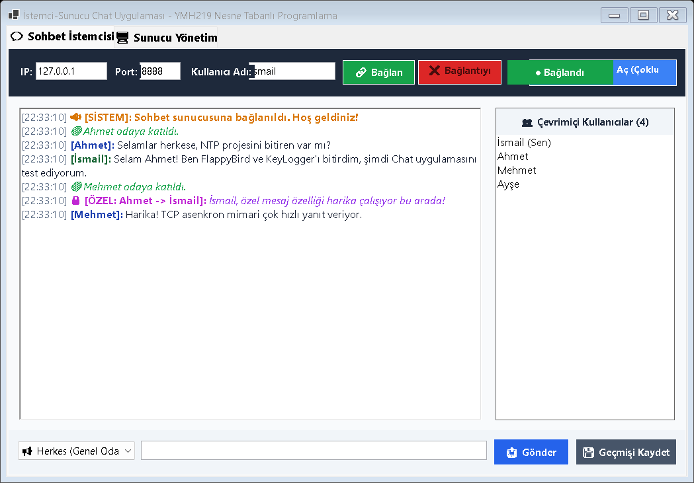
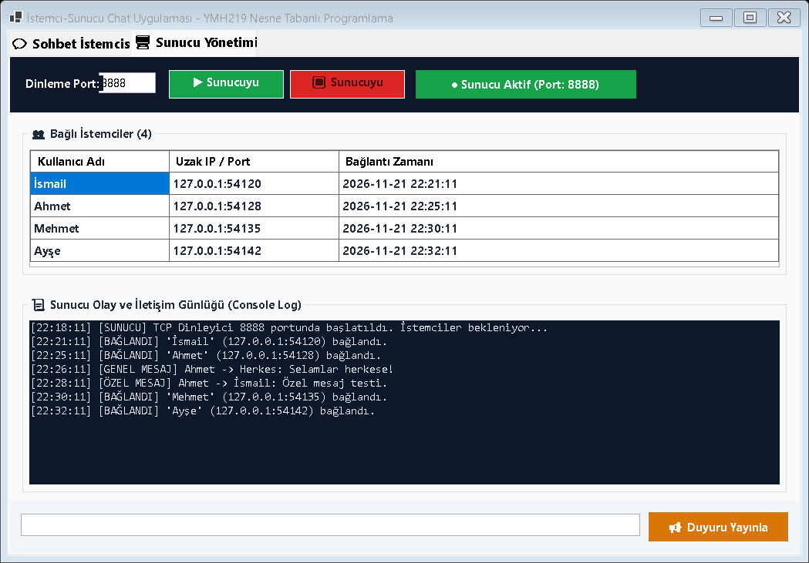

# YMH219 - Çoklu İstemci-Sunucu Sohbet Uygulaması (Client-Server Chat App)


Bu proje, **Nesne Tabanlı Programlama (YMH 219)** dersi laboratuvar / ek uygulama ödevleri kapsamında geliştirilmiş nesne yönelimli, çok iş parçacıklı (multithreaded) ve asenkron bir **İstemci-Sunucu (Client-Server) Masaüstü Sohbet Uygulaması**dır.

Uygulama; C# `System.Net.Sockets` (`TcpListener`, `TcpClient`), `NetworkStream`, `StreamReader`/`StreamWriter` ve `async/await` asenkron mimarisi üzerine kurulmuştur. Hem genel oda mesajlaşmasını hem de kullanıcılar arası birebir özel fısıltı (whisper) mesajlaşmasını JSON tabanlı bir protokolle destekler.

---

## 📸 Ekran Görüntüleri

| 💬 İstemci Sohbet Odası & Özel Mesajlaşma | 🖥️ Sunucu Yönetim Paneli & Canlı Bağlantılar |
| :---: | :---: |
|  |  |

---

## 🛠️ Kullanılan Teknolojiler ve Kütüphaneler

- **Programlama Dili:** C# 12
- **Çalışma Zamanı (Runtime):** .NET 8.0 Windows Desktop (`net8.0-windows`)
- **Arayüz Kütüphanesi:** Windows Forms (WinForms)
- **Ağ İletişimi (Networking):** `System.Net.Sockets.TcpListener`, `System.Net.Sockets.TcpClient`, `System.IO.StreamReader`, `System.IO.StreamWriter`
- **Serileştirme:** `System.Text.Json` (Tip güvenli, JSON tabanlı ağ protokolü)
- **Dosya I/O:** `System.IO.StreamWriter` (Sohbet geçmişi dışa aktarımı)
- **Asenkron Yapı:** `async` / `await`, `Task`, `CancellationTokenSource`
- **Harici Bağımlılık:** Harici üçüncü parti kütüphane gerektirmez, doğrudan .NET 8 BCL üzerinde çalışır.

---

## 🚀 Kurulum ve Çalıştırma Adımları

### Gereksinimler
- [.NET 8.0 SDK](https://dotnet.microsoft.com/download/dotnet/8.0) veya üzeri
- Windows 10 / 11 işletim sistemi
- Visual Studio 2022 veya VS Code / Terminal

### 1. Depoyu Klonlama
```bash
git clone https://github.com/ismailozdemir27/YMH219-ChatApp.git
cd YMH219-ChatApp
```

### 2. Projeyi Derleme
```bash
dotnet build
```

### 3. Uygulamayı Başlatma
```bash
dotnet run
```
*Veya projeyi Visual Studio 2022 ile açıp `F5` tuşu ile başlatabilirsiniz.*

### 4. Çoklu İstemci Testi (Aynı Bilgisayarda)
1. Uygulamayı başlattığınızda **Sunucu Yönetimi** sekmesinden *"Sunucuyu Başlat (▶)"* butonuna basınız (Varsayılan Port: `8888`).
2. **Sohbet Odası** sekmesine geçerek kullanıcı adınızı yazıp *"Bağlan (▶)"* butonuna tıklayınız.
3. Birden fazla istemciyi test etmek için pencerenin üst kısmındaki **"➕ Yeni İstemci Aç"** butonuna basarak istediğiniz kadar bağımsız istemci penceresi açabilir, farklı kullanıcı adlarıyla bağlanarak sohbet edebilirsiniz.

---

## ✨ Uygulamanın Temel Özellikleri

1. **Tam Asenkron TCP/IP Mimarisi:**
   - Arayüzün (UI Thread) kilitlenmesini ve donmasını önleyen `async`/`await` ve arka plan `StreamReader.ReadLineAsync` döngüsü.
   - İstemcilerin ani bağlantı kopmalarında veya sunucu kapandığında uygulamanın çökmesini engelleyen güvenli hata yakalama (`try-catch-finally`).

2. **Dinamik Çevrimiçi Kullanıcı Listesi:**
   - Yeni bir kullanıcı bağlandığında veya ayrıldığında sunucu tüm istemcilere güncel kullanıcı listesini (`MessageType.UserList`) otomatik olarak yayınlar (broadcast).
   - İstemcilerin listesi anlık senkronize olur.

3. **Özel Renklendirilmiş Mesaj Akışı (RichTextBox):**
   - **Kullanıcı Mesajları:** Mavi/Yeşil kullanıcı etiketi ve zaman damgası (`[HH:mm:ss]`).
   - **Özel Fısıltı Mesajları:** Mor renkte `🔒 [ÖZEL: Gönderen -> Alıcı]` formatında vurgulama.
   - **Sistem Bildirimleri:** Turuncu renkte `📢 [SİSTEM]` uyarıları.
   - **Giriş / Çıkış Bildirimleri:** Yeşil renkte katılım ve ayrılma mesajları.

4. **Sunucu Yönetim Paneli:**
   - Dinamik port belirleme ve tek tıkla sunucuyu başlatma/durdurma.
   - Bağlı istemcilerin kullanıcı adı, IP/Port uç noktası ve bağlantı zamanını gösteren canlı `DataGridView` tablosu.
   - Sunucu tarafında tüm ağ trafiğini ve olayları listeleyen gerçek zamanlı renkli konsol günlüğü.
   - Sunucu yöneticisinin tüm istemcilere tek seferde sistem duyurusu (`Duyuru Yayınla`) gönderebilmesi.

---

## 🌟 İsteğe Bağlı / Ek Puan Geliştirmeleri (Tam Puan Kapsamı)

Laboratuvar kılavuzunda belirtilen ek geliştirmelerin tamamı eksiksiz uygulanmıştır:

1. **Çoklu İstemci Desteği (Multi-Client Room):**
   - Tek bir sunucuya aynı anda onlarca istemci bağlanabilir; sunucu `ConcurrentDictionary` koleksiyonu ile her istemciyi bağımsız iş parçacığı üzerinden yönetir.
2. **Birebir Özel Mesajlaşma (Private Whispering):**
   - Alıcı kutusundan (`cmbRecipient`) veya çevrimiçi kullanıcılar listesinden bir kullanıcı seçildiğinde mesaj sadece o kullanıcıya ve gönderene iletilir. Diğer istemciler özel mesajı göremez.
3. **Sohbet Geçmişini Dosyaya Kaydetme (`StreamWriter`):**
   - *"Geçmişi Kaydet (💾)"* butonu ile mevcut sohbet dökümü, zaman damgaları, gönderen bilgileri ve özet istatistiklerle birlikte `.txt` dosyasına UTF-8 olarak aktarılır.
4. **Entegre Çoklu İstemci Test Penceresi (`ClientForm`):**
   - Ek bir derleme veya komut satırı gerektirmeden tek tıkla yeni istemci pencereleri üreten modüler yapı.

---

## 🏛️ Nesne Tabanlı Tasarım ve Proje Mimarisi

```
YMH219-ChatApp/
├── Enums/
│   ├── MessageType.cs          # PublicMessage, PrivateMessage, UserJoined, UserLeft, UserList, SystemNotification
│   └── ConnectionStatus.cs     # Disconnected, Connecting, Connected durumları
├── Models/
│   ├── ChatMessage.cs          # JSON serileştirilebilir mesaj modeli (Sender, Recipient, Content, Timestamp, Users)
│   └── ConnectedClient.cs      # Sunucuya bağlı istemci modeli (TcpClient, Streamler, IP, Bağlantı Zamanı)
├── Services/
│   └── ChatHistoryService.cs   # StreamWriter tabanlı sohbet geçmişi dışa aktarım servisi
├── Network/
│   ├── ChatServer.cs           # TcpListener tabanlı asenkron çok istemcili sunucu mimarisi
│   └── ChatClient.cs           # TcpClient tabanlı asenkron istemci ağ katmanı
├── Forms/
│   ├── MainForm.cs             # Çift sekmeli ana pencere (İstemci Odası + Sunucu Paneli)
│   ├── MainForm.Designer.cs    # Ana form tasarım bileşenleri
│   ├── ClientForm.cs           # Çoklu istemci testi için açılan bağımsız istemci formu
│   └── ClientForm.Designer.cs  # İstemci form bileşenleri
├── Program.cs                  # Giriş noktası ve otomatik ekran görüntüsü üreticisi
├── screenshots/                # README ekran görüntüleri
│   ├── client_chat.png
│   └── server.png
├── .gitignore                  # Visual Studio / .NET için tam yalıtım
└── ChatApp.csproj              # .NET 8.0 Windows Forms proje dosyası
```

---

## ⚠️ Bilinen Sınırlamalar / Güvenlik Notları

- **Ağ Kapsamı:** İletişim TCP/IP soketleri üzerinden yerel ağda (`LAN`) veya aynı bilgisayarda (`127.0.0.1 - localhost`) test edilmek üzere tasarlanmıştır. İnternet üzerinden test etmek için port yönlendirme (Port Forwarding) veya VPN gereklidir.
- **Şifreleme:** Veri iletimi JSON metin tabanlıdır (Eğitim amaçlı tasarlandığı için TLS/SSL sertifikası entegre edilmemiştir).
- **Kullanıcı Adı Çakışması:** Sunucu aynı kullanıcı adıyla ikinci bir bağlantıya izin vermez, benzersiz isim zorunluluğu vardır.

---

## 👤 Öğrenci Bilgileri

- **Adı - Soyadı:** İsmail Özdemir
- **Öğrenci Numarası:** 250541109
- **Ders:** Nesne Tabanlı Programlama (YMH 219)
- **Dönem:** 2026-2027 Güz
